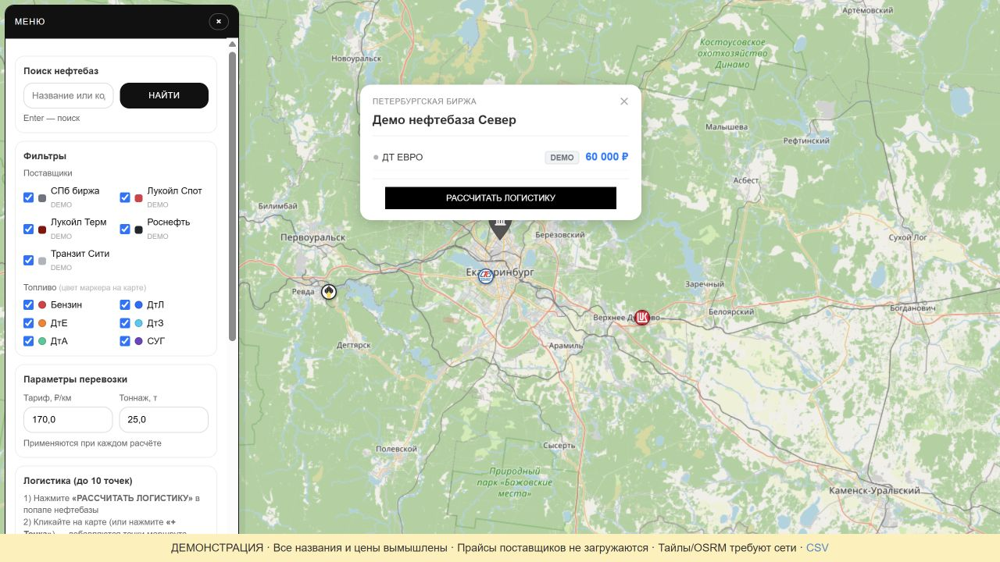

# Карта оптовых цен топлива

Генератор интерактивной карты нефтебаз и предложений топлива. Объединяет прайсы нескольких источников, сопоставляет предложения с координатами и помогает сравнить варианты поставки с учётом маршрута.

## Возможности

- Обработка PDF-прайсов СПбМТСБ и файлов Лукойла в XLSX/CSV.
- Объединение предложений Лукойл Спот и Терм по нефтебазе.
- Отдельные данные Роснефти и ценовых сообщений Telegram.
- Группировка нескольких предложений в одной точке карты.
- Маршруты OSRM и сравнение вариантов доставки.
- Генерация страницы Folium/Leaflet с локальными копиями части библиотек.

**Стек:** Python, pandas, pdfplumber, openpyxl, Folium/Leaflet, requests, BeautifulSoup, OSRM.


## Просмотр проекта

- `main.py` — обработка источников и генерация карты.
- `scripts/parse_tg_prices.py` — разбор ценовых сообщений.
- `scripts/fetch_and_update.py` — загрузка сообщений через Telegram Bot API.
- `public/index.html` — сохранённый результат генерации.

Сохранённая страница содержит только вымышленные демонстрационные предложения. Исходные коммерческие прайсы не входят в эту версию; рабочий запуск требует своих входных файлов и проверки актуальных форматов источников.

## Локальный запуск

```sh
python -m venv .venv
# Активируйте окружение: .venv\Scripts\activate в Windows
# или source .venv/bin/activate в Linux/macOS.
python -m pip install -r requirements.txt
python main.py
python -m http.server 8080 --directory public
```

Откройте `http://localhost:8080`. Перед повторной генерацией проверьте входные пути и источники в конфигурационном разделе `main.py`. Часть операций обращается к сети; доступность источников не гарантирована.

## Ограничения

Карточки поставщиков, картографические тайлы и маршруты зависят от внешних данных и сервисов. Форматы прайсов могут меняться. `deploy.sh` содержит пример серверной публикации с путями конкретного окружения; для локального просмотра он не требуется. CSV-экспорт и явное расписание доступны через run.py. Три теста проверяют сохранение секций Спот/Терм, безопасную запись CSV и перенос расписания на следующий день. Доступность поставщиков и точность маршрутов этими тестами не подтверждены.

История цен и расчёты доставки требуют проверки перед практическим использованием. Лицензия проекта пока не задана.

## Безопасная демонстрация и CSV

```sh
python -m pip install -r requirements.txt
python run.py --demo
python -m http.server 8762 --bind 127.0.0.1 --directory public
```

Откройте http://127.0.0.1:8762. Демо использует настоящие агрегатор, popup/UI и Folium renderer с вымышленными станциями. Прайсы поставщиков не загружаются; тайлы и маршруты используют публичные внешние сервисы. CSV сохраняет отдельные секции Спот/Терм и защищает строковые поля от spreadsheet formula injection.

Рабочий режим: `python run.py`. `OUTPUT_DIR` задаёт каталог HTML/CSV, `DATA_DIR` — каталог PDF. Для явного расписания: `python run.py --daily 14:05 --timezone Europe/Moscow` (в Windows может потребоваться пакет tzdata). Один процесс планировщика на одну выходную папку. Проверки: `python -m unittest discover -s tests -v`.

## Проверка и реальный экран

[Результаты и ограничения проверки](docs/verification.md). Скриншот получен при локальном запуске на вымышленных данных.


